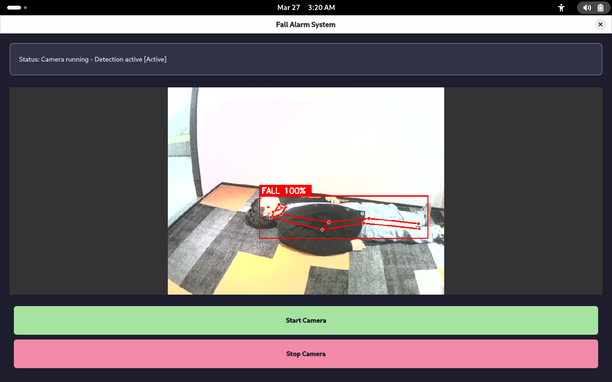
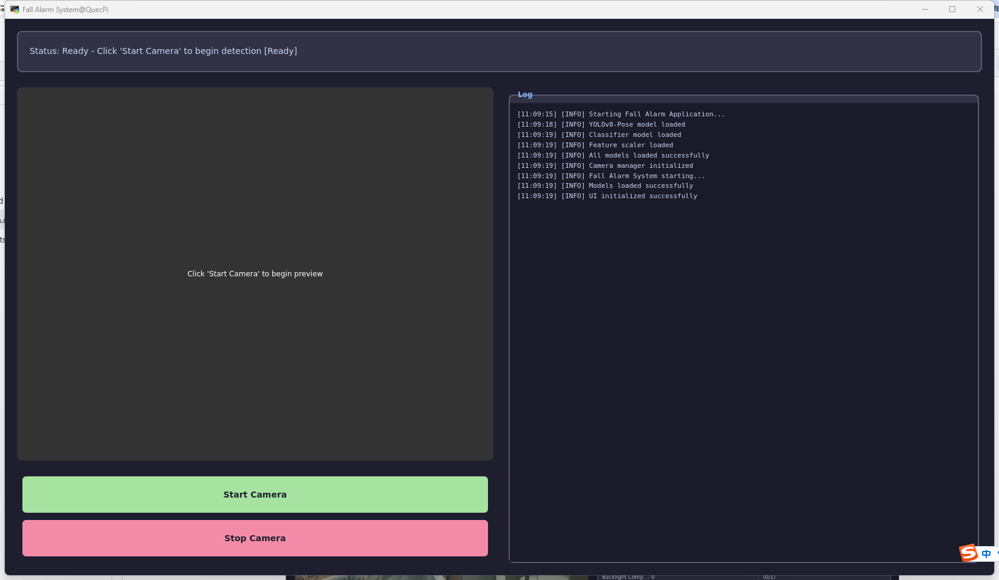

# 跌倒警报应用

[English](README.md) | 中文

本项目是一个基于 Quectel Pi H1 智能主控板实现的端侧跌倒检测应用：通过 USB 摄像头实时采集画面，利用 YOLOv8-Pose 提取人体关键点，再由预训练的随机森林分类器判断受监护人员是否发生跌倒；检测到跌倒时自动启动警报灯并上传报警图片。



## 功能特性
- 基于YOLOv8-Pose的实时人体姿态识别
   - 实时检测17个人体关键点
   - 支持多人同时检测
   - CPU推理，无需GPU
- 智能跌倒判断
   - 随机森林分类器判断姿态类别
   - 多特征融合（关键点、角度、身形）
   - 几何规则二次校验（躯干倾角、高宽比、关键点分布），两者同时满足才判定为跌倒
- 自动报警机制
   - 跌倒检测时启动警报灯
   - 自动保存报警图片
   - 上传至远程服务器，可在移动端 App 接收通知并查看
---

## 环境配置

### 系统要求
- **操作系统**: Linux/Debian 13
- **Python版本**: 3.8+
- **Qt版本**: Qt6（通过PySide6）
- **OpenCV版本**: 4.8+
- **PySide6版本**: 6.5+
- **numpy版本**: 1.24+
- **scikit-learn版本**: 1.3+
- **ultralytics版本**: 8.0+

### 系统依赖（Linux / Debian 13）

```bash
sudo apt update && sudo apt install -y \
    python3-pip \
    python3-venv \
    libopenblas-dev \
    libgl1 \
    libglx-mesa0 \
    libglib2.0-0t64 \
    v4l-utils
```

> 说明：Debian 13 已移除 `libatlas-base-dev`、`libjasper-dev`、`libgl1-mesa-glx` 等旧包名，科学计算底座统一为 `libopenblas-dev`；`v4l-utils` 提供排查摄像头用的 `v4l2-ctl`。

### 依赖安装（推荐使用虚拟环境）

```bash
python3 -m venv venv
source venv/bin/activate
pip install -r requirements.txt
```

> 串口库 `pyserial` 已包含在 `requirements.txt` 中，无需单独安装。

---

## 项目代码结构简介

```
├── requirements.txt             # Python依赖列表
├── README.md                    # 项目说明文档（英文）
├── README_zh.md                 # 项目说明文档（中文）
│
├── src/                         # 防跌倒检测应用源码目录
│   ├── main.py                  # 主入口，启动防跌倒检测应用
│   ├── camera_manager.py        # 摄像头管理类，负责视频采集、预览、跌倒检测
│   ├── fall_detector.py         # 跌倒检测器，YOLOv8推理和分类
│   ├── light_control.py         # 警报灯控制，通过串口通信
│   ├── ui_manager.py            # UI界面管理，PySide6 GUI实现
│   └── log_manager.py           # 日志管理类
│
├── model/                       # 预训练模型目录
│   ├── yolov8n-pose.pt                  # YOLOv8-Nano Pose模型
│   ├── fall_multi_person_model.pkl      # 随机森林分类器（跌倒判断）
│   ├── feature_scaler_multi.pkl         # 特征缩放器
│   └── model_info_multi.pkl             # 模型元信息
│
├── tools/                       # 演示资源与移动端安装包
│   ├── demo.png / demo2.png     # 界面演示图
│   └── FallAlarm.apk            # 移动端 App 安装包
│
└── picture/                     # 报警图片存储目录（运行时自动创建）
    ├── fall_20240326_143022.jpg # 报警图片示例
    └── ...
```
---

## 硬件要求

### USB摄像头（规格不硬性要求，以下是本项目使用规格）
- **接口类型**: USB
- **分辨率要求**: 
  - 推荐分辨率: 1280×720或更高
  - 支持其他分辨率的标准USB摄像头
- **帧率**: 支持15fps以上
- **输出格式**: YUYV/MJPG

### 警报灯（可选）
- **接口类型**: USB转串口或GPIO
- **通信协议**: 串口通信（波特率9600 bps）
- **控制命令**: 十六进制指令序列

### 运行环境
- **开发板/PC**: 支持USB摄像头的Linux设备
- **内存**: 建议2GB以上（YOLOv8推理需要）
- **GPU**: 不要求（纯CPU计算）
- **网络**: 可选（用于上传报警图片到服务器）

---

## 使用流程

### 完整防跌倒检测流程

```
┌─────────────────────────────────────────────────────────────
│                   防跌倒检测应用使用流程                     
├─────────────────────────────────────────────────────────────
│  第一步：准备模型文件                                        
│  ├── 下载 yolov8n-pose.pt 到 model/ （或直接使用当前model目录下的）                       
│  ├── 准备 fall_multi_person_model.pkl         
│  └── 准备 feature_scaler_multi.pkl             
│                                                             
│  第二步：安装依赖                                            
│  ├── python3 -m venv venv && source venv/bin/activate       
│  └── pip install -r requirements.txt                        
│                                                              
│  第三步：运行防跌倒检测应用                                  
│  ├── cd src                                                 
│  ├── python3 main.py（需先激活 venv）                        
│  ├── 启动摄像头预览和检测                            
│  └── 检测到跌倒时自动启动报警                                
│                                                                                       
└─────────────────────────────────────────────────────────────
```

### 安装依赖

**运行命令：**
```bash
python3 -m venv venv
source venv/bin/activate
pip install -r requirements.txt
```

**串口权限（警报灯功能，可选）：**
```bash
sudo usermod -a -G dialout $USER  # 配置串口权限，重新登录后生效
```

### 运行应用

**运行命令：**
```bash
cd src
python3 main.py    # 请确保已激活 venv（source ../venv/bin/activate）
```



**应用界面说明：**

| 界面区域 | 功能说明 |
|---------|---------|
| 摄像头预览 | 显示实时视频流，标注检测到的人体和跌倒状态 |
| 日志区域 | 显示模型加载、检测结果、警报状态等日志信息 |
| 报警提示 | 顶部显示跌倒警报信息（带时间戳） |
| 状态栏 | 显示当前摄像头、FPS、检测状态 |

**演示案例**


---

## 检测参数配置

**关键点与几何规则参数**（`src/fall_detector.py`）：

```python
# 关键点检测配置
MIN_CONFIDENCE = 0.4           # 关键点置信度阈值
MIN_KEYPOINTS = 10             # 有效关键点最少数量
YOLO_IMG_SIZE = 320            # YOLOv8输入图像大小

# 跌倒判断阈值（几何规则）
FALL_BODY_ANGLE_THRESHOLD = 55        # 躯干倾角阈值（度），倾角 > 该值计分
FALL_HEIGHT_RATIO_THRESHOLD = 1.2     # 身高/肩宽比（H/W），比值 < 该值计分
```

**分类器与检测频率参数**（`src/camera_manager.py`）：

```python
DETECT_INTERVAL = 0.15            # 检测间隔（秒）
FALL_CONFIDENCE_THRESHOLD = 0.75  # 分类器/置信度阈值
FALL_DISPLAY_DURATION = 1.0       # 检出后画面继续标注的时长（秒）
```

### 服务器配置

报警图片上传相关配置在 `src/camera_manager.py` 中：

```python
SERVER_IP = "118.31.23.236"   # 替换为你的服务器IP地址
SERVER_UPLOAD_URL = f"http://{SERVER_IP}:8000/upload_fall"  # 替换成你自己的服务端上传接口
self._fall_save_interval = 1.0  # 报警图片保存/上传的最小间隔（秒）
```

> 当前版本上传为后台异步、不阻断主程序；暂未提供"禁用上传"的开关，如需关闭请自行注释 `_save_fall_detection()` 中的上传调用。

## 技术原理

### 跌倒检测流程

```
视频采集
   ↓
YOLOv8-Pose关键点检测（17个关键点）
   ↓
特征提取（关键点、角度、身形）
   ↓
特征标准化（使用scaler）
   ↓
随机森林分类器推理（标签 2 = 跌倒）
   ↓
几何规则二次校验（躯干倾角、高宽比、关键点分布）
   ↓
两者同时满足且置信度 ≥ FALL_CONFIDENCE_THRESHOLD
   ↓
触发警报 → 启动警报灯 → 保存图片 → 上传服务器
```


## 常见问题

### 模型加载

**Q: 模型加载失败，显示"Model not found"**

A: 检查以下几点：
1. 确保 `model/` 目录存在
2. 检查模型文件名是否正确
   - `yolov8n-pose.pt`
   - `fall_multi_person_model.pkl`
   - `feature_scaler_multi.pkl`
3. 尝试手动下载模型：
   ```bash
   mkdir -p model
   wget https://github.com/ultralytics/assets/releases/download/v0.0.0/yolov8n-pose.pt \
        -O model/yolov8n-pose.pt
   ```

### 摄像头

**Q: 找不到摄像头或摄像头无法打开**

A: 检查摄像头连接：
```bash
# 1) 先确认 USB 总线上是否枚举出摄像头（最关键）
lsusb
dmesg | grep -i uvc

# 2) 再查看视频设备节点
ls -la /dev/video*

# 3) 使用 v4l2-ctl 查看详细信息（需 apt install v4l-utils）
v4l2-ctl --list-devices
v4l2-ctl --list-formats -d /dev/video0
```

> ⚠️ QCS6490 板载双 ISP / 硬件编解码会产生大量 `/dev/video*` 节点（如 video0/1/10/32/33），**即使不插摄像头也存在**，因此不能仅凭 `ls -la /dev/video*` 判断摄像头是否识别成功，应优先看 `lsusb` / `dmesg`。

**Q: 摄像头预览卡顿或延迟大**

A: 优化性能：
1. 降低分辨率：改为640×480
2. 增加检测间隔：`DETECT_INTERVAL = 0.25`（`src/camera_manager.py`）
3. 降低YOLOv8输入尺寸：`YOLO_IMG_SIZE = 256`（`src/fall_detector.py`）；尺寸过小会显著降低远处/遮挡目标的检测置信度，建议调整后实测复测
4. 排查摄像头采集侧：分辨率过高、MJPG 未生效等（图片上传为后台异步，一般不会阻塞主线程）

### 跌倒检测

**Q: 误报率高（正常动作被当作跌倒）**

A: 调整参数降低误报：
1. 提高分类器/置信度阈值：`FALL_CONFIDENCE_THRESHOLD = 0.80`（`src/camera_manager.py`）
2. 提高几何规则阈值，使判定更严格（`src/fall_detector.py`）：
   - `FALL_BODY_ANGLE_THRESHOLD = 65`（原 55，倾角 > 该值才计分，调大更严格）
   - `FALL_HEIGHT_RATIO_THRESHOLD = 1.0`（原 1.2，H/W < 该值才计分，调小更严格）
3. 重新训练分类器，增加坐下、弯腰等负样本

**Q: 漏检率高（没有检测到实际跌倒）**

A: 调整参数提高灵敏度：
1. 降低分类器/置信度阈值：`FALL_CONFIDENCE_THRESHOLD = 0.65`（`src/camera_manager.py`）
2. 放宽几何规则阈值（`src/fall_detector.py`）：
   - `FALL_BODY_ANGLE_THRESHOLD = 50`（原 55，调小才放宽）
   - `FALL_HEIGHT_RATIO_THRESHOLD = 1.4`（原 1.2，调大才放宽）
3. 放宽关键点门槛：`MIN_KEYPOINTS = 8`、`MIN_CONFIDENCE = 0.3`
4. 优化摄像头视角（距离1-3m，高度1.5-2m）

**Q: 只能识别特定方向的跌倒**

A: 重新训练模型：
1. 在训练数据集中增加多个方向的跌倒样本
2. 包括向前、向侧面、向后倾倒
3. 增加数据量（每类至少500张）
4. 重新运行训练脚本


## 性能优化

### 推理加速

```python
# 降低YOLOv8输入尺寸（src/fall_detector.py）
YOLO_IMG_SIZE = 256  # 从320降低；尺寸过小会降低远处/遮挡目标的检出率

# 增加检测间隔（src/camera_manager.py）
DETECT_INTERVAL = 0.2  # 从0.15增加
```

### 内存优化

```python
# 定期清理日志
if len(LogManager._logs) > 100:
    LogManager.clear_logs()
```

限制报警图片保存频率：`src/camera_manager.py` 中的 `self._fall_save_interval = 1.0`（默认 1 秒最多保存一张）。

### 降低误报

提高分类器阈值并收紧几何规则：

```python
# src/camera_manager.py
FALL_CONFIDENCE_THRESHOLD = 0.80   # 分类器/置信度 >= 0.8

# src/fall_detector.py
FALL_BODY_ANGLE_THRESHOLD = 65     # 倾角阈值调大更严格
FALL_HEIGHT_RATIO_THRESHOLD = 1.0  # H/W 阈值调小更严格
```

---